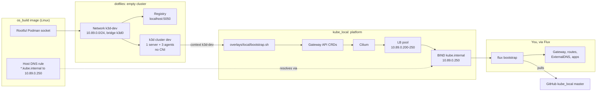
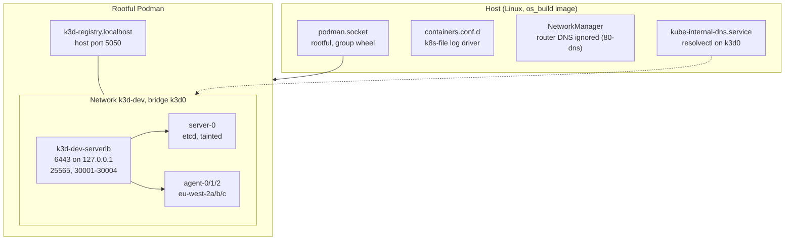

# Local Kubernetes

dotfiles creates an empty k3d cluster; on Linux the host side (rootful Podman
socket, logging, `kube.internal` DNS) comes from the os_build image. It stops there:
no CNI, nodes `NotReady`. The `kube_local` repo takes it from there. That split
means the cluster can be bootstrapped with a different CNI or GitOps tool without
touching dotfiles.

## How the repos fit

The three repos don't call each other. They agree on these values, so change both
sides together:

| Value | dotfiles / os_build | kube_local |
| --- | --- | --- |
| Cluster `dev`, context `k3d-dev` | `home/dot_config/k3d/config.yaml` | `bootstrap.sh` default argument |
| API endpoint `k3d-dev-serverlb:6443` | k3d's load balancer | `k8sServiceHost` in `overlays/local/cilium-values.yaml` |
| Network `10.89.0.0/24` | `kube-create` in `home/dot_zshrc` | LB pool in `overlays/local/lb-ipam.yaml` |
| DNS `10.89.0.250`, zone `kube.internal` | os_build `kube-internal-dns.service` | `overlays/local/dns/bind.yaml` |
| flannel, kube-proxy, servicelb, traefik, network policy off | k3s args | Cilium replaces all of them |
| Registry `k3d-registry.localhost:5000` | `kube-create` | image references, Flux image automation |

## What dotfiles and the image set up

| Command | Does |
| --- | --- |
| `90-podman-machine` (chezmoi, macOS) | Makes the Podman machine rootful with 8 GB. Linux uses the image's socket. |
| `30-krew` (chezmoi) | Installs the `access-matrix` and `rbac-tool` kubectl plugins. |
| `kube-create` | Network, registry, cluster, then pins the node IPs. |
| `kube-delete` | Cluster only; network and registry stay. |
| `kube-up` | Starts the registry and the cluster, then lists nodes. |
| `kube-down` | Stops the cluster and the registry. Nothing starts at boot. |

> [!NOTE]
> The k3d containers use `unless-stopped`, so a reboot with the cluster up brings
> back `server-0` alone and the API is unreachable. `kube-up` fixes it, and
> `kube-down` before a reboot keeps everything off.

> [!IMPORTANT]
> Podman gives every node a new IP on each start. etcd records `server-0`'s IP
> as its peer URL, so k3s then won't start ("not a member of the etcd cluster"),
> and Cilium keeps tunnelling to the agents' old IPs, so cross-node pod traffic
> (DNS included) times out. `kube-create` pins the IPs the nodes got. For an
> older cluster, per node: `kpodman stop <node>`,
> `kpodman network disconnect k3d-dev <node>`,
> `kpodman network connect --ip <IP> k3d-dev <node>`, `kpodman start <node>`.
> Use the server's old IP from its "Found [...]" log line. If agents moved, pin
> them where they are and run `kubectl --context k3d-dev -n kube-system rollout restart ds/cilium`.

Then switch to `kube_local` and run `./overlays/local/bootstrap.sh`.

## Decisions

Runtime

- Rootful Podman on every OS. Cilium loads BPF programs, and atomic Fedora
  disables unprivileged BPF. On Linux the system socket is opened to `wheel` so
  k3d runs without sudo. `kpodman` reaches it; plain `podman` is rootless and
  sees nothing.
- brew Podman is macOS-only. On Linux it shadowed `/usr/bin/podman` and broke.
  brew Docker is gone; `DOCKER_HOST` points k3d at Podman.
- Podman logs to files, not journald (set in the image). Its journald reader
  failed while k3d waited for the server; `kube-create` and `kube-up` also retry.

Cluster shape (`home/dot_config/k3d/config.yaml`)

- 1 server + 3 agents, server tainted `NoSchedule`, embedded etcd: workloads see
  only worker nodes, as on EKS.
- EKS-style region, zone, instance-type and nodegroup labels on the agents.
- k3s 1.36, a minor EKS still supports.
- API server bound to `127.0.0.1`. Ports 25565 and 30001-30004 are mapped to the
  host and reachable from the LAN.
- No shared bpffs mount: each node gets its own, or pinned maps collide.

Network and DNS

- A fixed network so LB IPs and the DNS route never move.
- Kubelet gets its own `resolv.conf`. Otherwise pods inherited the host's
  `fritz.box` search domain and every external lookup stalled first.
- DNS-over-TLS everywhere: the host, rootless and rootful containers (the
  image turns on DNS for the default `podman` network, so aardvark-dns forwards
  to resolved) and pods. Wired connections ignore the FRITZ!Box, which only
  speaks plain DNS to LAN clients.
- `*.kube.internal` goes to `10.89.0.250` over `k3d0` only, without DoT or
  DNSSEC. Nothing answers until kube_local starts BIND.

Tooling

- Flux CLI from `fluxcd/tap` (brew's `flux` is InfluxData's), plus `hubble`,
  `k9s`, `helm`, `cilium-cli`. k9s gets the Flux plugins
  (`home/dot_config/k9s/plugins.yaml`).
- For the kube_local lessons: `mkcert`, `sops`, `age`, `ko`, `kwok`.
- For EKS: `eks-node-viewer`, `iamlive` (the IAM actions a command needs), and
  krew's `access-matrix` and `rbac-tool` for RBAC.
- The starship prompt shows the context: green for `k3d-*`, red for anything
  else, EKS ARNs shortened to `eks:<cluster>`.
- BPF tools for the BPF Performance Tools book come from the OS image.

On macOS the cluster runs inside a rootful `applehv` Podman machine, so the
`10.89.0.x` addresses and host DNS rule don't apply; use `kubectl port-forward`.
