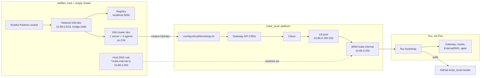
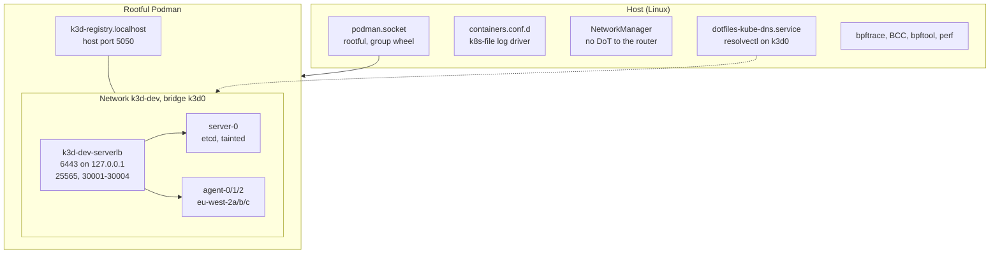

# Local Kubernetes

dotfiles prepares the host and creates an empty k3d cluster. It stops there:
no CNI, nodes `NotReady`. The `kube_local` repo takes it from there. That split
means the cluster can be bootstrapped with a different CNI or GitOps tool without
touching dotfiles.

## How the two repos fit

The repos don't call each other. They agree on these values, so change both
sides together:

| Value | dotfiles | kube_local |
| --- | --- | --- |
| Cluster `dev`, context `k3d-dev` | `home/dot_config/k3d/config.yaml` | `bootstrap.sh` default argument |
| API endpoint `k3d-dev-serverlb:6443` | k3d's load balancer | `k8sServiceHost` in `overlays/local/cilium-values.yaml` |
| Network `10.89.0.0/24` | `_CLUSTER_SUBNET` in `services/k8s.py` | LB pool in `overlays/local/lb-ipam.yaml` |
| DNS `10.89.0.250`, zone `kube.internal` | `_KUBE_DNS_SERVER`, `_KUBE_DNS_DOMAIN` | `overlays/local/dns/bind.yaml` |
| flannel, kube-proxy, servicelb, traefik, network policy off | k3s args | Cilium replaces all of them |
| Registry `k3d-registry.localhost:5000` | created by `services/k8s.py` | image references, Flux image automation |

## What dotfiles sets up

| Command | Does |
| --- | --- |
| `uv run python -m dotfiles --only k8s` | Socket, logging, host DNS unit. One sudo prompt. |
| `uv run python -m dotfiles --only bpf` | Layers `bpftrace`, `bcc-tools`, `bpftool` and `perf`; reboot after. |
| `uv run python -m dotfiles --only krew` | Installs the `access-matrix` and `rbac-tool` kubectl plugins. |
| `uv run python -c 'from dotfiles.services import k8s; k8s.create_cluster()'` | Network, registry, cluster. |
| `uv run python -c 'from dotfiles.services import k8s; k8s.delete_cluster()'` | Cluster only; network and registry stay. |

Then switch to `kube_local` and run `./overlays/local/bootstrap.sh`.

## Decisions

Runtime

- Rootful Podman on every OS. Cilium loads BPF programs, and atomic Fedora
  disables unprivileged BPF. On Linux the system socket is opened to `wheel` so
  k3d runs without sudo. `kpodman` reaches it; plain `podman` is rootless and
  sees nothing.
- brew Podman is macOS-only. On Linux it shadowed `/usr/bin/podman` and broke.
  brew Docker is gone; `DOCKER_HOST` points k3d at Podman.
- Podman logs to files, not journald. Its journald reader failed while k3d waited
  for the server; cluster create also retries three times.

Cluster shape (`home/dot_config/k3d/config.yaml`)

- 1 server + 3 agents, server tainted `NoSchedule`, embedded etcd: workloads see
  only worker nodes, as on EKS.
- EKS-style region, zone, instance-type and nodegroup labels on the agents.
- k3s 1.36, a minor EKS still supports.
- API server bound to `127.0.0.1`. Ports 25565 and 30001-30004 are mapped to the
  host and reachable from the LAN.
- No shared bpffs mount: each node gets its own, or pinned maps collide.

Network and DNS

- A fixed network so LB IPs and the DNS route never move.
- Kubelet gets its own `resolv.conf`. Otherwise pods inherited the host's
  `fritz.box` search domain and every external lookup stalled first.
- DNS-over-TLS stays on globally but is off for the router's resolvers. The
  FRITZ!Box only speaks DoT upstream, not to LAN clients.
- `*.kube.internal` goes to `10.89.0.250` over `k3d0` only, without DoT or
  DNSSEC. Nothing answers until kube_local starts BIND.

Tooling

- Flux CLI from `fluxcd/tap` (brew's `flux` is InfluxData's), plus `hubble`,
  `k9s`, `helm`, `cilium-cli`. k9s gets the Flux plugins
  (`home/dot_config/k9s/plugins.yaml`).
- For the kube_local lessons: `mkcert`, `sops`, `age`, `ko`, `kwok`.
- For EKS: `eks-node-viewer`, `iamlive` (the IAM actions a command needs), and
  krew's `access-matrix` and `rbac-tool` for RBAC.
- The starship prompt shows the context: green for `k3d-*`, red for anything
  else, EKS ARNs shortened to `eks:<cluster>`.
- `bpf` step for the BPF Performance Tools book.

On macOS the cluster runs inside a rootful `applehv` Podman machine, so the
`10.89.0.x` addresses and host DNS rule don't apply; use `kubectl port-forward`.
