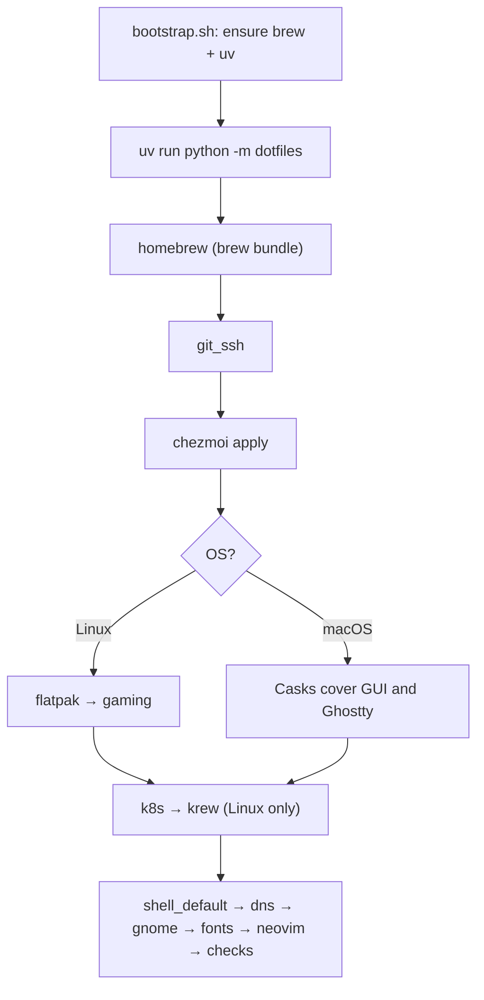

# Dotfiles

Reproducible setup for three targets that share one bootstrap and the same tooling:

- **macOS**
- **Bazzite** (atomic Fedora, gaming built in)
- **Fedora Silverblue** (atomic Fedora)

## Model

- **Home files → chezmoi** (`home/` source state via `.chezmoiroot`).
- **CLI tools → Homebrew** (`brewfile`), shared across targets with small per-OS sections.
- **GUI apps → Homebrew Casks on macOS, native Flatpak on Linux** (`flatpaks`).
- **Ghostty, Albert, BPF tools** → Homebrew cask (Ghostty) on macOS; built into the OS image on Linux, never layered.
- **Gaming** → native on Bazzite; Flatpaks (`flatpaks-gaming`) on Silverblue (+ optional rebase note).
- **Containers** → Apple `container` and brew Podman on macOS; the OS's own `podman` on Linux. k3d uses rootful Podman on both.
- **Local Kubernetes** → a 4-node k3d cluster on rootful Podman, empty until the `kube_local` repo bootstraps it. See [kubernetes.md](kubernetes.md).
- **kubectl plugins** → the `krew` step installs `access-matrix` and `rbac-tool` for reading RBAC from the terminal.
- **Linux system config** → the [os_build](https://github.com/bourbonfgiles/os_build) image: DNS over TLS, and k3d's rootful `podman.socket`, logging and `kube.internal` DNS. dotfiles only writes `$HOME` there, plus one `nmcli` setting.
- **GNOME desktop** → Dash to Dock + Tiling Shell on Linux from `dconf/`, no suspend on AC (the KVM keyboard dies after resume); Hammerspoon on macOS.

Flatpaks install via a dedicated step (not `brew bundle`). Flatpak **overrides** are applied by chezmoi under `~/.local/share/flatpak/overrides/`.

## Quick start

```bash
git clone git@github.com:bourbonfgiles/dotfiles.git ~/repos/personal/dotfiles
sh ~/repos/personal/dotfiles/bootstrap.sh
```

`bootstrap.sh` ensures Homebrew + uv, then `uv run python -m dotfiles` runs ordered steps: brew bundle, git/ssh, **chezmoi apply**, Linux Flatpaks and gaming, Kubernetes runtime, krew plugins, shell, DNS drop-ins, GNOME, fonts, neovim, checks.

```bash
uv run python -m dotfiles --list
uv run python -m dotfiles --only chezmoi
uv run python -m dotfiles --dry-run          # log mutations, don't apply
uv run python -m dotfiles --yes              # non-interactive (no prompts)
uv run python -m dotfiles --only checks --strict   # fail if a tool is missing
```

## Bootstrap flow



## Chezmoi layout

`.chezmoiroot` → `home/`:

```
home/
  dot_zshrc              → ~/.zshrc
  dot_gitconfig.tmpl     → ~/.gitconfig   (from .chezmoidata.toml)
  dot_config/…           → ~/.config/…
  dot_local/share/flatpak/overrides/… → flatpak overrides
  dot_config/eza/theme.yml → ~/.config/eza/theme.yml (Smyck)
```

```bash
chezmoi --source ~/repos/personal/dotfiles apply
```

Git identity:

- **Personal** (committed): `home/.chezmoidata.toml` → global `~/.gitconfig`
- **Work** (not in git): copy `chezmoi.toml.example` → `~/.config/chezmoi/chezmoi.toml`, fill `[data.git.work]`, apply. That writes `~/.config/git/config-work`, included only for `~/repos/vitalhub/` via `includeIf`.

## Repository structure

```
home/             Chezmoi source state
brewfile          Homebrew packages
flatpaks*         Flathub app ID lists
bootstrap.sh      Fresh-machine entry
dconf/            GNOME extension dconf
src/dotfiles/     Bootstrap package (stdlib only)
  services/       homebrew, git_ssh, chezmoi, flatpak, …
tests/
```

## Notes (Bazzite / Silverblue)

- chezmoi only writes `$HOME` — install via Homebrew.
- Nothing is layered with `rpm-ostree`: packages belong in the OS image.
- Plain Silverblue lacks what the os_build image adds (DNS over TLS, the k3d socket); rebase onto it or add them by hand.
- Neovim config is chezmoi-managed; the neovim step only syncs plugins. lazy.nvim's luarocks support is off (its Lua build needs readline headers Bazzite lacks); plugins that ship rockspecs get their dependencies as ordinary plugins instead.

## Notes (brew on macOS)

Tap installs such as `brew install hashicorp/tap/*` can fail with `could not read Username for 'https://github.com'`: brew's git has no stored GitHub credential and won't prompt. Make brew's git (only) use SSH:

```ini
# /opt/homebrew/etc/gitconfig (Linuxbrew: /home/linuxbrew/.linuxbrew/etc/gitconfig)
[credential]
    helper = osxkeychain

[url "git@github.com:"]
    insteadOf = https://github.com/
```

## Ghostty

Config is split under `home/dot_config/ghostty/`:

- `config` — includes the fragments
- `appearance` (Smyck) / `input` / `quake` / `platform`
- `quake` is a template: the quick terminal (``cmd+` ``) on macOS only, because GNOME has no wlr-layer-shell.

## Dev checks

```bash
uv run ruff check src tests && uv run ruff format src tests
uv run mypy src
uv run pytest
```
